# Lampiran: Screenshot & Angka Ringkasan

Seluruh gambar diambil dari aplikasi yang benar-benar berjalan (emulator Android) dan
dari halaman GitHub Actions repo publik. Data uji sudah dihapus setelah pengambilan gambar.

---

## A. Peran Admin

### Gambar 4.1 Tampilan halaman login aplikasi

{ width="300" }

**Berkas:** `01-login.png`

**Isi:** Halaman masuk dengan dua kolom (USERNAME, PASSWORD), tombol **Masuk** indigo, dan teks bantuan "Lupa password? Hubungi admin bengkel". Latar gelap dengan kartu putih dan monogram "MP".

**Fungsi:** Satu-satunya pintu masuk aplikasi; belum ada halaman publik lain. Autentikasi memakai token Sanctum yang disimpan di perangkat.

---

### Gambar 4.2 Beranda admin berisi ringkasan penggajian

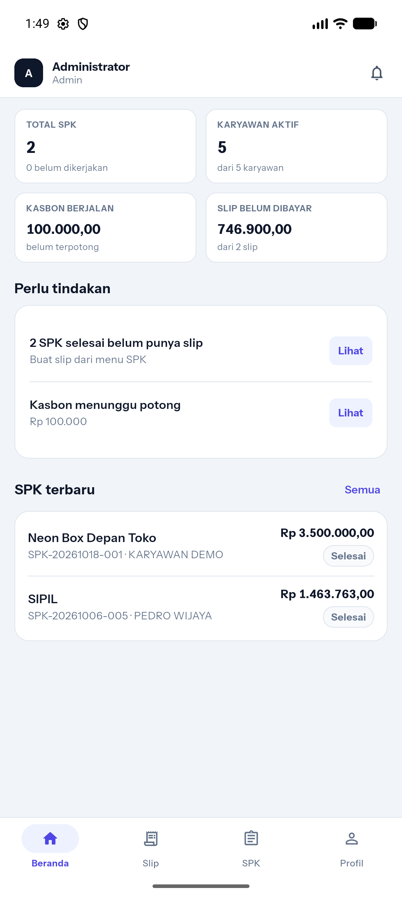{ width="300" }

**Berkas:** `02-beranda-admin.png`

**Isi:** Header "Administrator / Admin" + ikon lonceng dengan badge **2**. Empat kartu statistik: TOTAL SPK **2** (0 belum dikerjakan), KARYAWAN AKTIF **5** (dari 5 karyawan), KASBON BERJALAN **100.000,00**, SLIP BELUM DIBAYAR **746.900,00**. Di bawahnya panel **Perlu tindakan** dan kartu **SPK terbaru** (SIPIL · SPK-20261006-005 · Rp 1.463.763,00 · Selesai).

**Fungsi:** Ringkasan kondisi penggajian sekaligus daftar pekerjaan yang menunggu tindakan admin — inilah "dashboard" yang diminta pada analisis kebutuhan.

---

### Gambar 4.3 Daftar slip gaji beserta status pembayaran

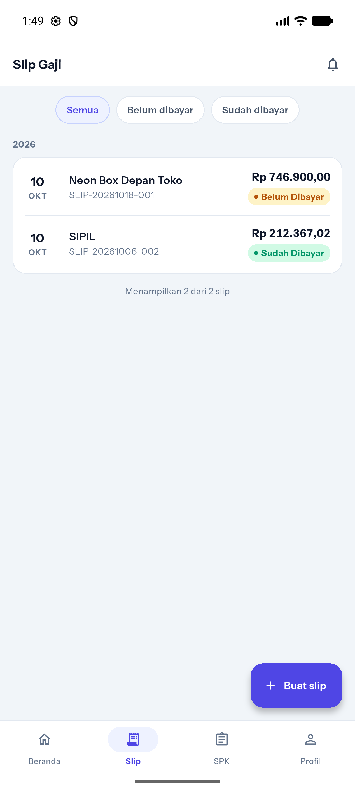{ width="300" }

**Berkas:** `03-slip-list-admin.png`

**Isi:** Daftar slip dengan filter status (**Semua / Belum dibayar / Sudah dibayar**) dan tahun (2026). Dua baris: `10 OKT · Neon Box Depan Toko · SLIP-20261018-001 · Rp 746.900,00 · Belum Dibayar` dan `10 OKT · SIPIL · SLIP-20261006-002 · Rp 212.367,02 · Sudah Dibayar`. Footer: "Menampilkan 2 dari 2 slip" + tombol **Buat slip**.

**Fungsi:** Bukti fitur daftar + filter; status pembayaran terlihat tanpa membuka detail.

---

### Gambar 4.4 Rincian perhitungan gaji pada slip digital

{ width="300" }

**Berkas:** `04-slip-detail.png`

**Isi:** Slip bergaya struk: kop **MANN PLUS ADVERTISING**, No. Slip `SLIP-20261018-001`, Periode Oktober 2026, Tanggal 18 Okt 2026, Nama **KARYAWAN DEMO**, NIK, Jabatan, Pekerjaan, lalu rincian **Nilai SPK → PPN 3% → Nilai bersih → Komisi 22% → Tunjangan makan → Potongan kasbon → GAJI BERSIH**, badge status, QR verifikasi, dan tombol **Bagikan** / **Unduh PDF**.

**Fungsi:** Inti penelitian — transparansi perhitungan gaji. Setiap komponen ditampilkan terpisah sehingga karyawan bisa mencocokkan angka.

---

### Gambar 4.5 Slip gaji diunduh sebagai berkas PDF

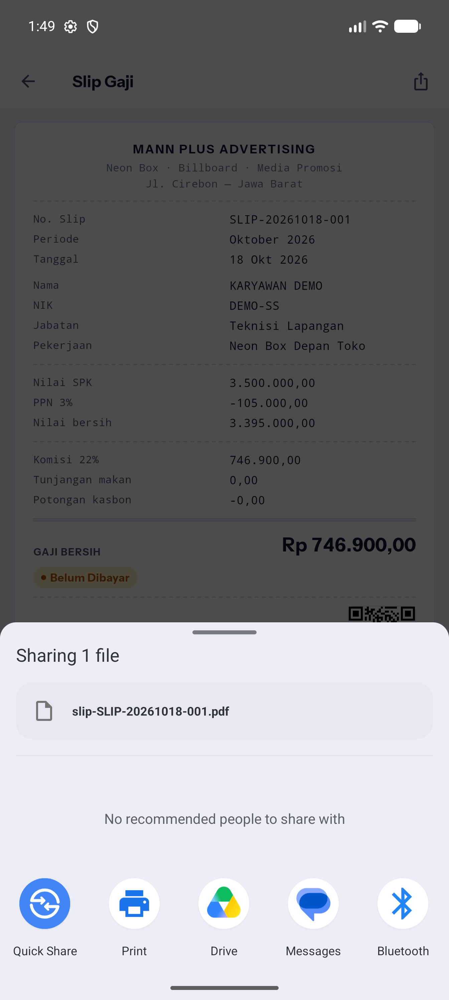{ width="300" }

**Berkas:** `06-slip-pdf-share.png`

**Isi:** Lembar berbagi Android setelah menekan **Unduh PDF**: "Sharing 1 file — `slip-SLIP-20261018-001.pdf`" dengan pilihan Quick Share, Print, Drive, Messages, Bluetooth.

**Fungsi:** Membuktikan slip benar-benar dihasilkan sebagai PDF (dompdf) dan bisa dikirim/dicetak.

---

### Gambar 4.6 Daftar SPK dengan status pekerjaan

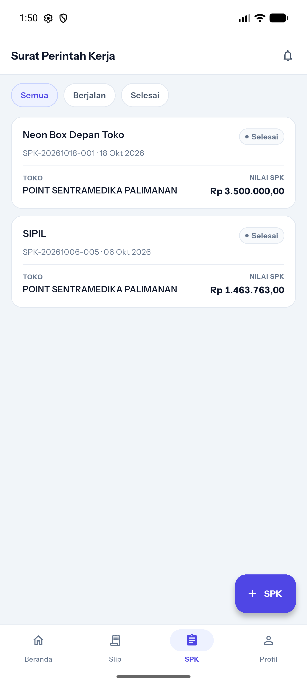{ width="300" }

**Berkas:** `07-spk-list.png`

**Isi:** Daftar Surat Perintah Kerja dengan filter **Semua / Berjalan / Selesai**. Dua kartu: `Neon Box Depan Toko · Selesai · SPK-20261018-001`, `SIPIL · Selesai · SPK-20261006-005`, masing-masing menampilkan toko, nilai SPK, dan status. Tombol **SPK** di kanan bawah untuk menambah.

**Fungsi:** Bukti modul SPK sebagai sumber data perhitungan gaji.

---

### Gambar 4.7 Form input SPK

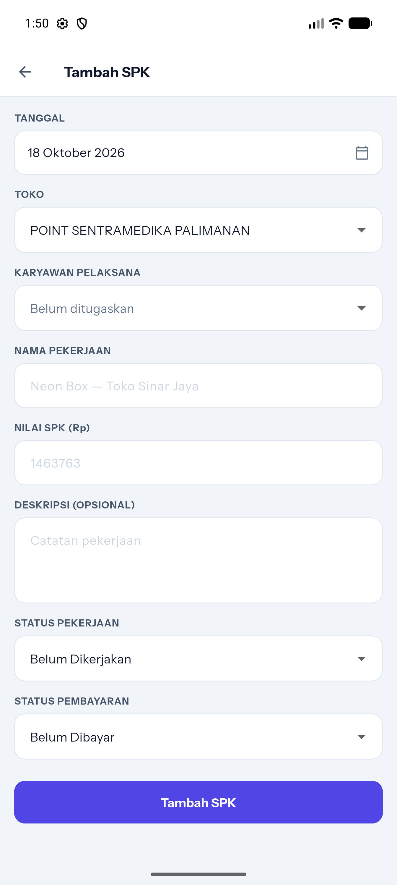{ width="300" }

**Berkas:** `08-spk-form.png`

**Isi:** Form **Tambah SPK**: Tanggal (18 Oktober 2026), Toko (POINT SENTRAMEDIKA PALIMANAN), Karyawan pelaksana, Nama pekerjaan, Nilai SPK (Rp), Deskripsi opsional, Status pekerjaan.

**Fungsi:** Menunjukkan admin bisa membuat SPK langsung dari ponsel, bukan hanya dari web.

---

### Gambar 4.8 Halaman profil admin

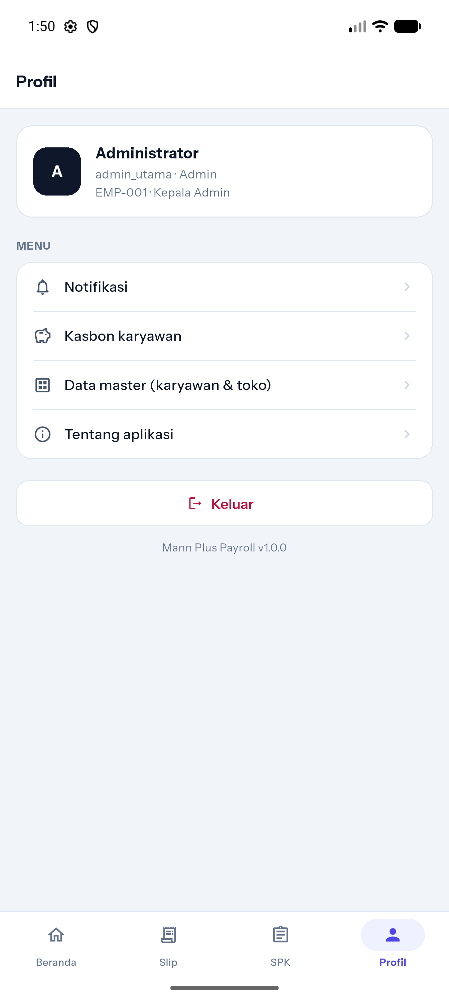{ width="300" }

**Berkas:** `09-profil-admin.png`

**Isi:** Kartu identitas (Administrator · admin_utama · Admin · EMP-001 · Kepala Admin) dan menu: Notifikasi, Kasbon karyawan, Data master (karyawan & toko), Tentang aplikasi, Keluar. Versi aplikasi `Mann Plus Payroll v1.0.0`.

**Fungsi:** Pusat navigasi fitur pendukung + bukti peran (role) melekat pada akun.

---

### Gambar 4.9 Daftar kasbon karyawan

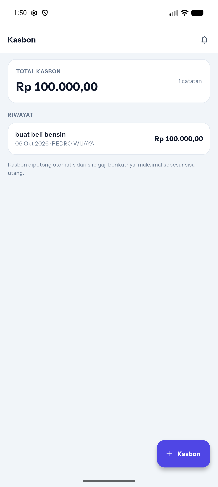{ width="300" }

**Berkas:** `10-kasbon-list.png`

**Isi:** Ringkasan **TOTAL KASBON Rp 100.000,00 · 1 catatan**, riwayat `buat beli bensin · 06 Okt 2026 · PEDRO WIJAYA · Rp 100.000,00`, dan catatan bahwa kasbon dipotong otomatis dari slip berikutnya **maksimal sebesar sisa utang**.

**Fungsi:** Bukti aturan pengaman yang ditemukan pada audit (potongan tidak boleh melebihi utang).

---

### Gambar 4.10 Form pencatatan kasbon

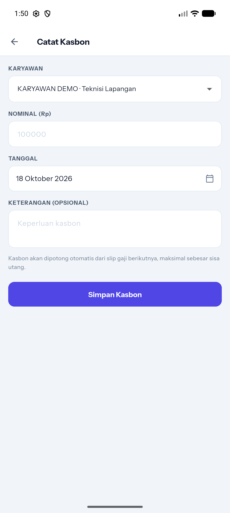{ width="300" }

**Berkas:** `11-kasbon-form.png`

**Isi:** Form **Catat Kasbon**: pilih karyawan (KARYAWAN DEMO · Teknisi Lapangan), nominal, tanggal (18 Oktober 2026), keterangan opsional, tombol **Simpan Kasbon**, plus penjelasan mekanisme potong otomatis.

**Fungsi:** Menunjukkan pencatatan kasbon dilakukan di tempat, langsung terhubung ke perhitungan gaji.

---

### Gambar 4.11 Data master karyawan

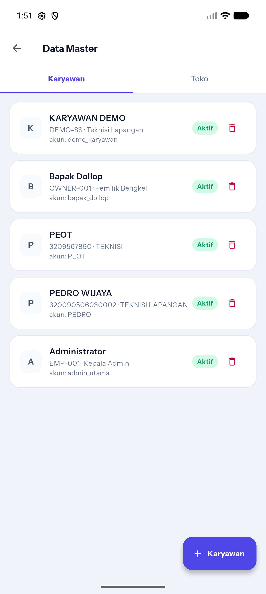{ width="300" }

**Berkas:** `12-master-data.png`

**Isi:** Tab **Karyawan** pada Data Master: lima baris (KARYAWAN DEMO, Bapak Dollop, PEOT, PEDRO WIJAYA, Administrator) masing-masing dengan NIK, jabatan, username akun, dan status **Aktif**.

**Fungsi:** Bukti pengelolaan data induk — akun login dibuat bersamaan dengan data karyawan.

---

### Gambar 4.12 Form tambah karyawan beserta akun login

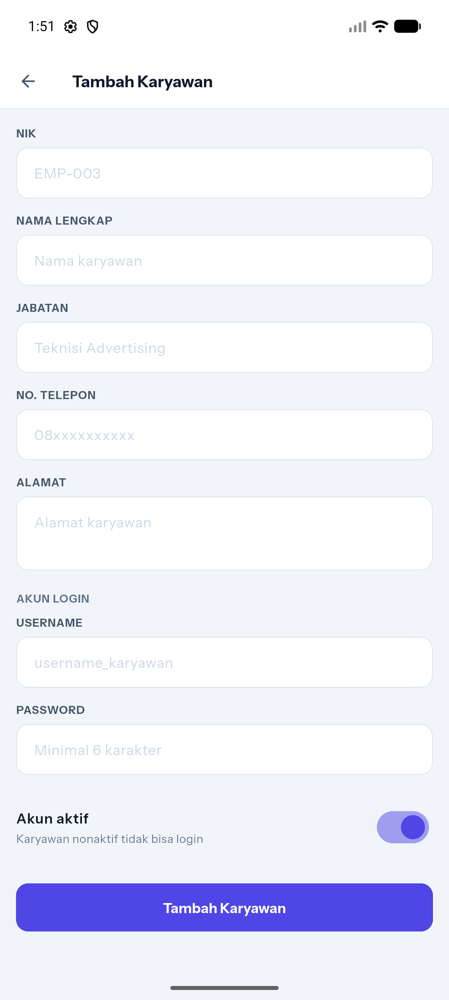{ width="300" }

**Berkas:** `13-karyawan-form.png`

**Isi:** Form **Tambah Karyawan**: NIK, Nama lengkap, Jabatan, No. telepon, Alamat, lalu blok **Akun login** (username, password) dan sakelar **Akun aktif** dengan catatan "Karyawan nonaktif tidak bisa login".

**Fungsi:** Menunjukkan satu formulir membuat data karyawan sekaligus akun login — dan ada kontrol keamanan untuk menonaktifkan akun.

---

### Gambar 4.13 Data toko

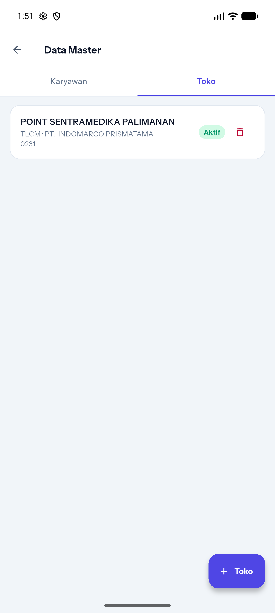{ width="300" }

**Berkas:** `14-toko-list.png`

**Isi:** Tab **Toko**: `POINT SENTRAMEDIKA PALIMANAN · TLCM · PT. INDOMARCO PRISMATAMA · 0231 · Aktif`.

**Fungsi:** Data toko dipakai sebagai atribut SPK sehingga laporan bisa dikelompokkan per toko.

---

### Gambar 4.14 Daftar notifikasi di dalam aplikasi

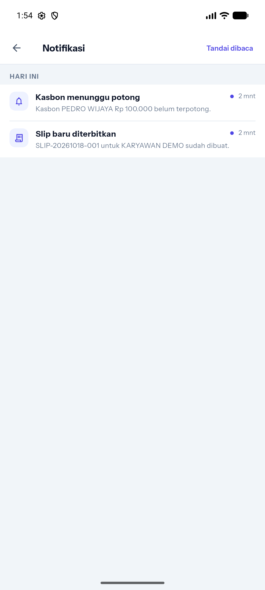{ width="300" }

**Berkas:** `15-notifikasi.png`

**Isi:** Daftar notifikasi in-app: **Kasbon menunggu potong** ("Kasbon PEDRO WIJAYA Rp 100.000 belum terpotong") dan **Slip baru diterbitkan** ("SLIP-20261018-001 untuk KARYAWAN DEMO sudah dibuat"), masing-masing dengan waktu ("2 mnt") dan tombol **Tandai dibaca**.

**Fungsi:** Bukti notifikasi tersimpan di database (bukan hanya push sekali lewat) sehingga bisa dibaca ulang kapan saja.

---

### Gambar 4.15 Form pembuatan slip gaji

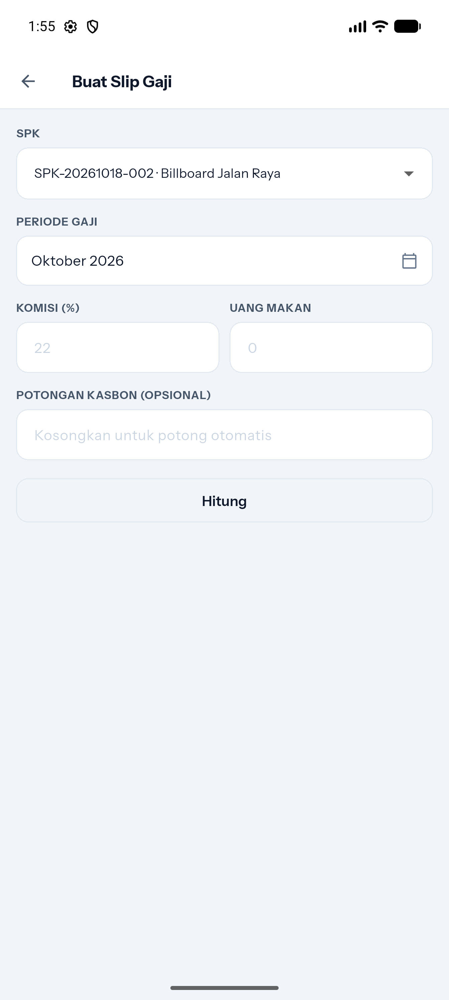{ width="300" }

**Berkas:** `16-buat-slip.png`

**Isi:** Form **Buat Slip Gaji**: pilih SPK (`SPK-20261018-002 · Billboard Jalan Raya`), Periode gaji (Oktober 2026), Komisi (%), Uang makan, Potongan kasbon (opsional), tombol **Hitung**.

**Fungsi:** Memperlihatkan alur kerja admin: SPK → hitung → simpan slip.

---

### Gambar 4.16 Pratinjau perhitungan gaji sebelum slip disimpan

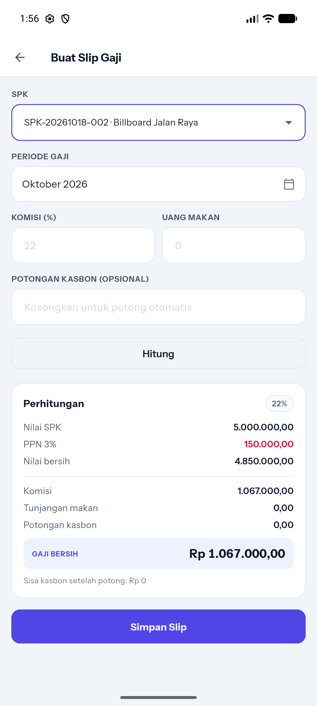{ width="300" }

**Berkas:** `17-pratinjau-gaji.png`

**Isi:** Setelah menekan **Hitung**, muncul kartu **Perhitungan**: `Nilai SPK 5.000.000,00`, `PPN 3% 150.000,00`, `Nilai bersih 4.850.000,00`, `Komisi 22%`, tunjangan, dan gaji bersih; tombol **Simpan Slip**.

**Fungsi:** **Bukti utama validasi rumus** — angka bisa dicocokkan manual di BAB IV (5.000.000 × 3% = 150.000; 4.850.000 × 22% = 1.067.000).

---

### Gambar 4.17 Detail SPK

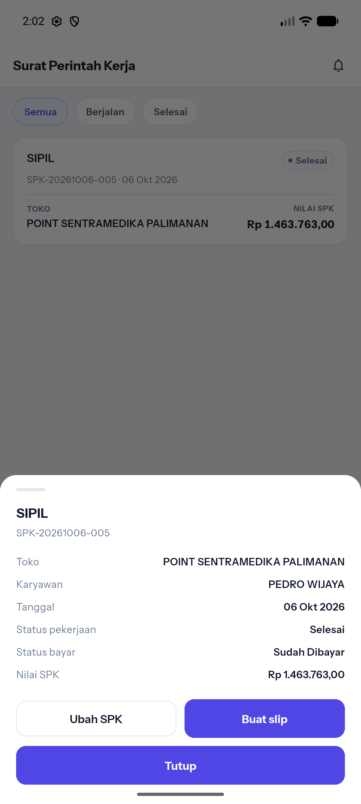{ width="300" }

**Berkas:** `30-spk-edit.png`

**Isi:** Layar detail/ubah SPK: `SIPIL · SPK-20261006-005`, Toko POINT SENTRAMEDIKA PALIMANAN, Karyawan PEDRO WIJAYA, Tanggal 06 Okt 2026, Status pekerjaan **Selesai**, Status bayar **Sudah Dibayar**.

**Fungsi:** Bukti data SPK bisa ditelusuri dan diubah; status bayar SPK mengikuti slip.

---

### Gambar 4.18 Informasi aplikasi

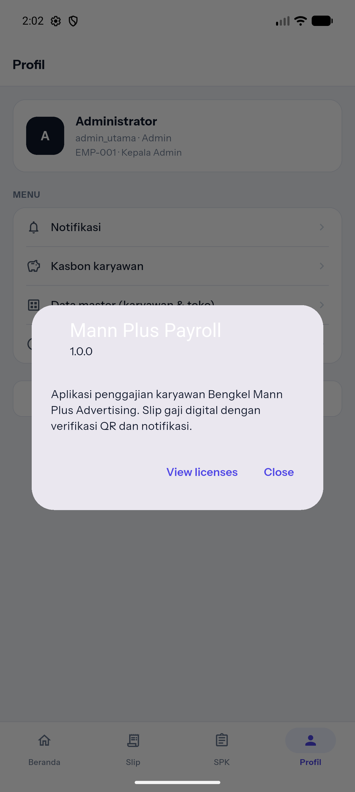{ width="300" }

**Berkas:** `31-tentang-aplikasi.png`

**Isi:** Dialog **Mann Plus Payroll 1.0.0** dengan deskripsi singkat aplikasi dan tautan lisensi.

**Fungsi:** Pelengkap (attribution) — menunjukkan aplikasi punya identitas versi.

---

## B. Peran Karyawan

### Gambar 4.19 Beranda karyawan

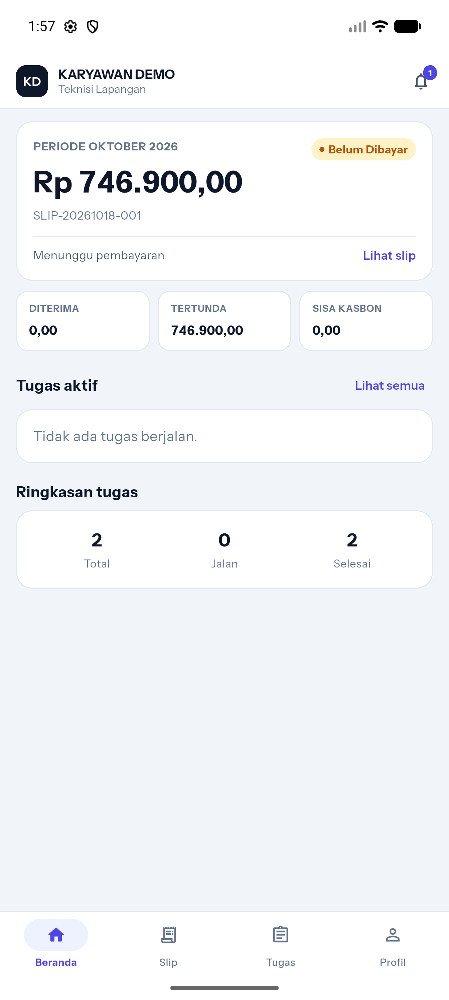{ width="300" }

**Berkas:** `18-beranda-karyawan.png`

**Isi:** Header "KARYAWAN DEMO / Teknisi Lapangan". Kartu slip periode **OKTOBER 2026**: `Rp 746.900,00`, nomor `SLIP-20261018-001`, status **Belum Dibayar**, "Menunggu pembayaran", tombol **Lihat slip**. Tiga kartu: **DITERIMA 0,00**, **TERTUNDA 746.900,00**, **SISA KASBON**. Bagian **Tugas aktif** ("Tidak ada tugas berjalan") dan **Ringkasan tugas** (1 total, 0 jalan, 1 selesai).

**Fungsi:** Karyawan langsung tahu berapa yang sudah dan belum diterima tanpa bertanya ke admin.

---

### Gambar 4.20 Daftar slip milik karyawan

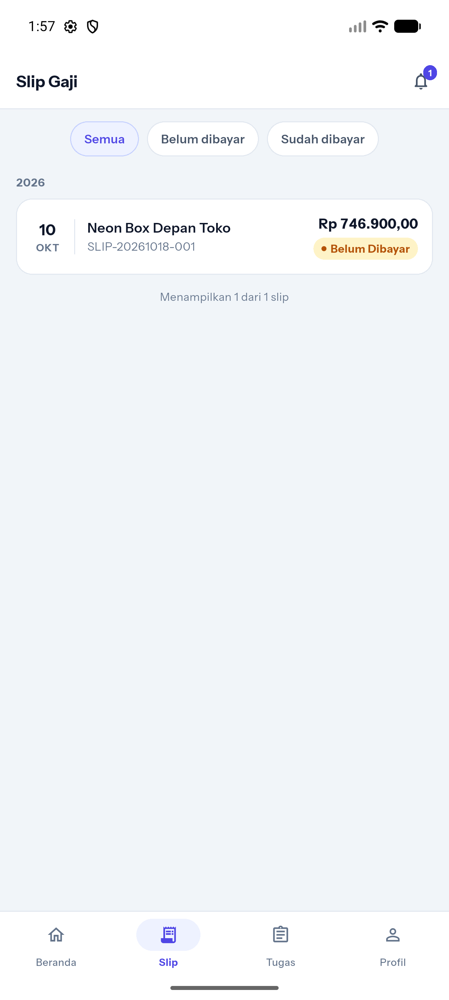{ width="300" }

**Berkas:** `19-slip-list-karyawan.png`

**Isi:** Hanya **1 slip** tampil (`SLIP-20261018-001 · Rp 746.900,00 · Belum Dibayar`), "Menampilkan 1 dari 1 slip", tanpa tombol Buat slip.

**Fungsi:** **Bukti pembatasan hak akses** — karyawan hanya melihat slip miliknya sendiri, dan menu pembuatan slip tidak tersedia untuk perannya.

---

### Gambar 4.21 Rincian slip yang dilihat karyawan

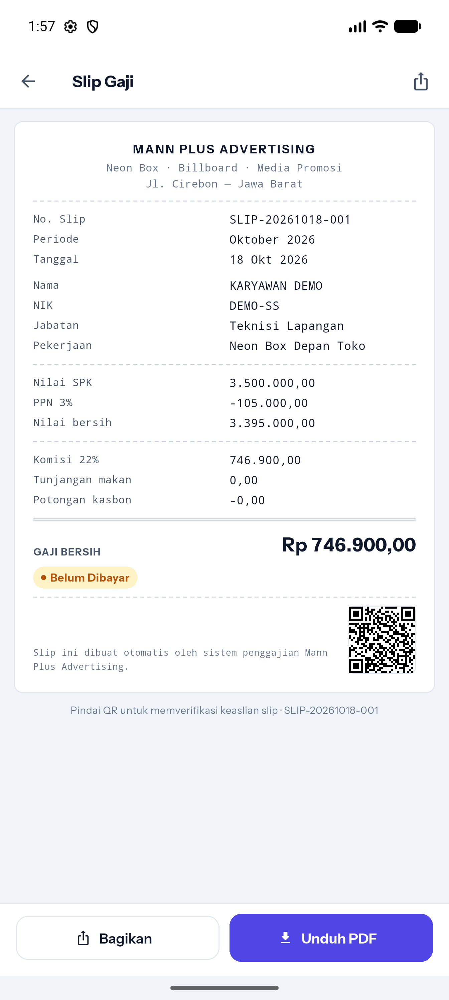{ width="300" }

**Berkas:** `20-slip-detail-karyawan.png`

**Isi:** Tampilan struk yang sama seperti sisi admin (rincian PPN, komisi, tunjangan, potongan, gaji bersih, QR verifikasi).

**Fungsi:** Menegaskan tidak ada perbedaan data antara yang dilihat karyawan dan yang dihitung sistem.

---

### Gambar 4.22 Daftar tugas karyawan

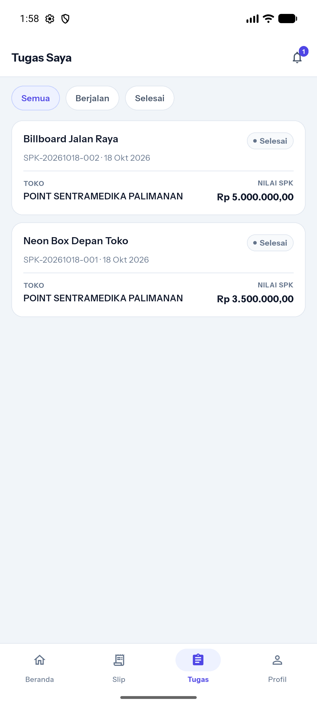{ width="300" }

**Berkas:** `21-tugas-karyawan.png`

**Isi:** Tab **Tugas Saya** dengan filter Semua/Berjalan/Selesai; dua kartu: `Billboard Jalan Raya · Selesai · SPK-20261018-002` dan `Neon Box Depan Toko · Selesai · SPK-20261018-001`.

**Fungsi:** Karyawan bisa memantau pekerjaan yang ditugaskan kepadanya (nama tab berubah dari "SPK" menjadi "Tugas" sesuai peran).

---

### Gambar 4.23 Halaman profil karyawan

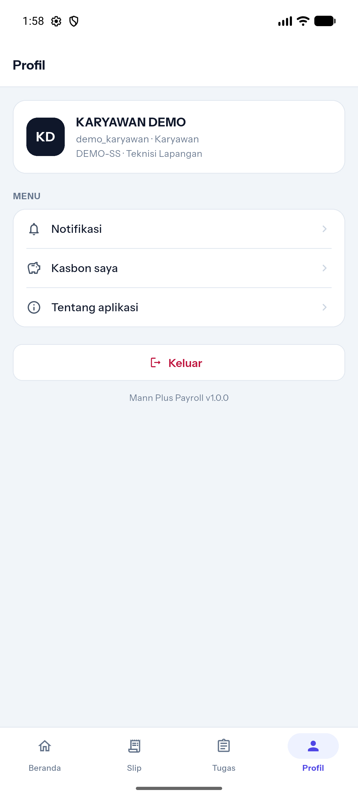{ width="300" }

**Berkas:** `22-profil-karyawan.png`

**Isi:** Profil karyawan: `KD · KARYAWAN DEMO · demo_karyawan · Karyawan · DEMO-SS · Teknisi Lapangan`, menu Notifikasi, **Kasbon saya**, Tentang aplikasi, Keluar.

**Fungsi:** Bukti antarmuka menyesuaikan peran (menu "Kasbon karyawan" milik admin menjadi "Kasbon saya" untuk karyawan).

---

## C. Peran Owner

### Gambar 4.24 Beranda owner (ringkasan bengkel)

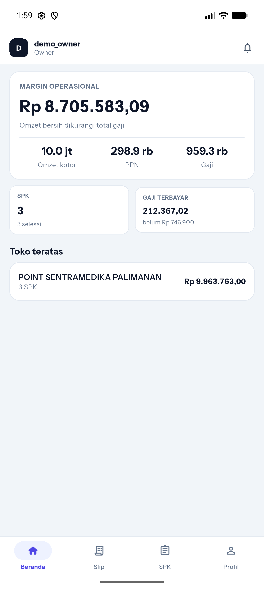{ width="300" }

**Berkas:** `23-beranda-owner.png`

**Isi:** Beranda pemilik: **MARGIN OPERASIONAL Rp 8.705.583,09** ("Omzet bersih dikurangi total gaji"), omzet `10.0 jt`, kartu **SPK 3** (3 selesai), **GAJI TERBAYAR 212.367,02** (belum Rp 746.900), dan **Toko teratas** POINT SENTRAMEDIKA PALIMANAN (3 SPK · Rp 9.963.763,00).

**Fungsi:** Ringkasan tingkat bengkel untuk pemilik — bukan detail operasional, tapi margin dan produktivitas toko.

---

## D. CI/CD

### Gambar 4.25 Daftar pipeline pada repositori backend

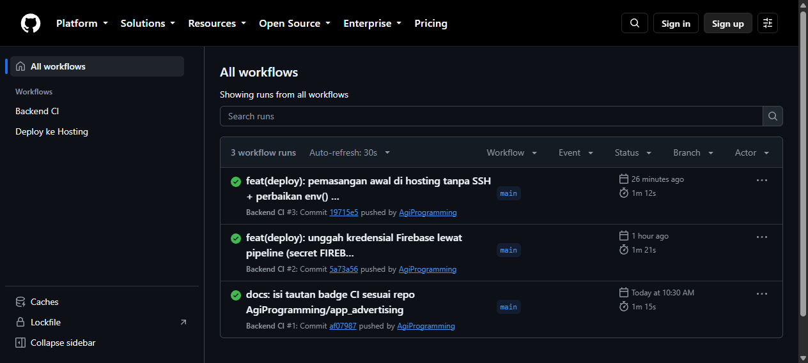{ width="300" }

**Berkas:** `24-ci-github-actions-list.png`

**Isi:** Halaman **Actions** repo `AgiProgramming/app_advertising`: daftar workflow (`Backend CI`, `Deploy ke Hosting`) beserta status run terakhir.

**Fungsi:** Menunjukkan pipeline tersimpan di repositori dan berjalan otomatis di server GitHub.

---

### Gambar 4.26 Hasil eksekusi pipeline backend

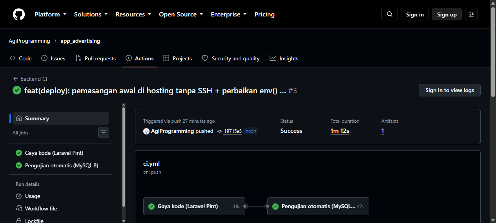{ width="300" }

**Berkas:** `25-ci-backend-run.png`

**Isi:** Ringkasan run **Backend CI**: commit `19715e5`, **Success**, durasi **1m 12s**, **1 artefak**, dua job hijau — `Gaya kode (Laravel Pint)` (18s) dan `Pengujian otomatis (MySQL 8)` (47s).

**Fungsi:** **Bukti utama CI** — setiap push diuji otomatis terhadap database MySQL 8.

---

### Gambar 4.27 Daftar pipeline pada repositori aplikasi mobile

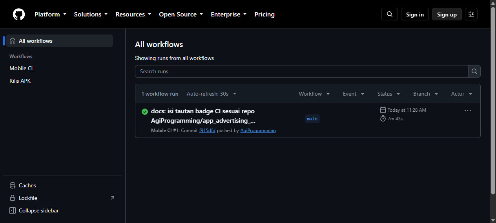{ width="300" }

**Berkas:** `26-ci-mobile-list.png`

**Isi:** Halaman Actions repo `app_advertising_mobile`: workflow `Mobile CI` dan `Rilis APK`.

**Fungsi:** Pipeline terpisah untuk aplikasi mobile (analisis, uji, build).

---

### Gambar 4.28 Hasil eksekusi pipeline mobile

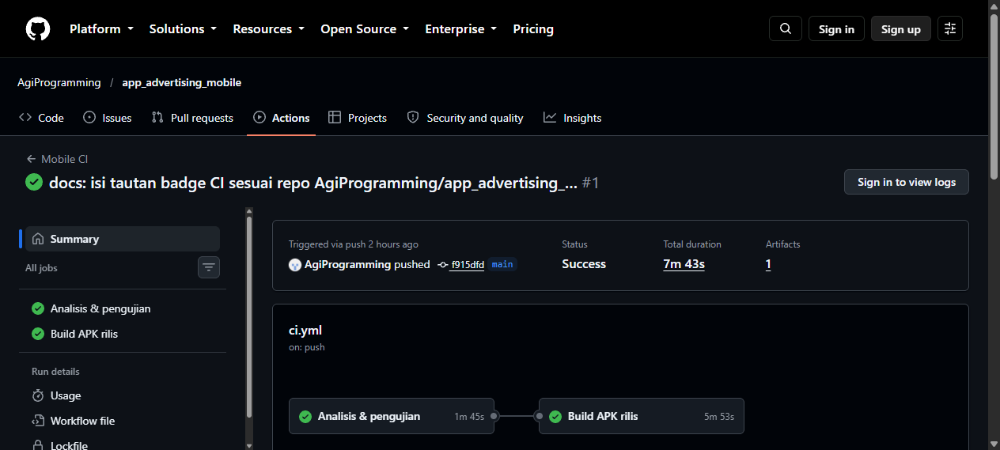{ width="300" }

**Berkas:** `27-ci-mobile-run.png`

**Isi:** Run **Mobile CI** pada commit "docs: isi tautan badge CI…" — status hijau, memuat langkah analisis statis, pengujian, dan build APK.

**Fungsi:** Menunjukkan kualitas aplikasi mobile dijaga otomatis (analyzer + widget test).

---

### Gambar 4.29 Definisi pipeline dalam bentuk kode

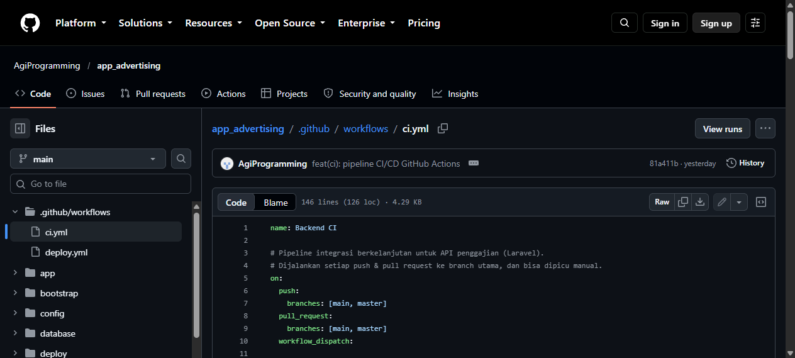{ width="300" }

**Berkas:** `28-ci-workflow-file.png`

**Isi:** Berkas `.github/workflows/ci.yml` yang terbuka di GitHub — definisi pipeline dalam bentuk kode (pemicu `on: push`, `jobs`, `services: mysql:8.0`, langkah `composer install`, `php artisan test`).

**Fungsi:** Mendukung konsep **pipeline as code** pada BAB II.

---

### Gambar 4.30 Badge status pipeline pada repositori

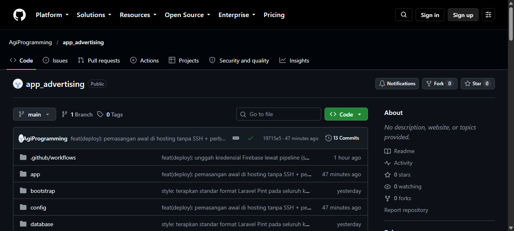{ width="300" }

**Berkas:** `29-repo-readme-badge.png`

**Isi:** Halaman utama repo backend: README proyek + **badge status** pipeline di bagian atas.

**Fungsi:** Badge memberi informasi status build tanpa membuka tab Actions.

---

### Gambar 4.31 Eksekusi continuous deployment ke hosting

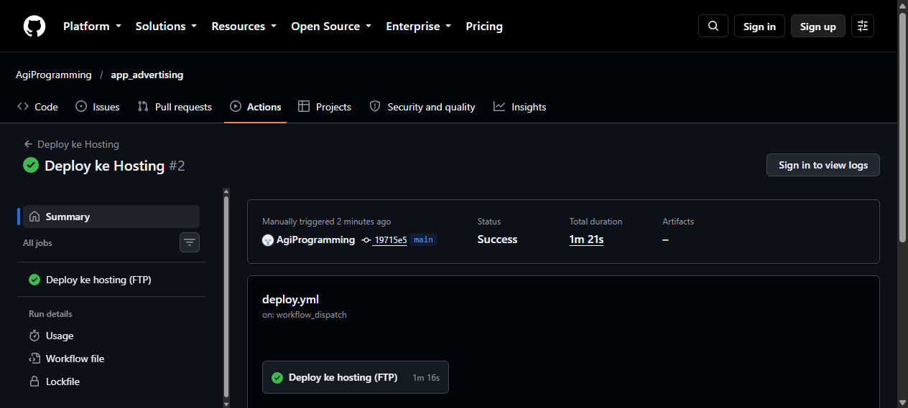{ width="300" }

**Berkas:** `32-ci-deploy-run.png`

**Isi:** Run **Deploy ke Hosting**: 11 langkah hijau — *Siapkan PHP 8.3, Pasang dependensi, Paketkan rilis, Unggah ke hosting (FTPS), Unggah kredensial Firebase, Ekstrak & migrasi di hosting* — total ±1m 10s.

**Fungsi:** **Bukti continuous deployment** ke hosting tanpa SSH.

---

### Gambar 4.32 Rilis APK otomatis pada GitHub Release

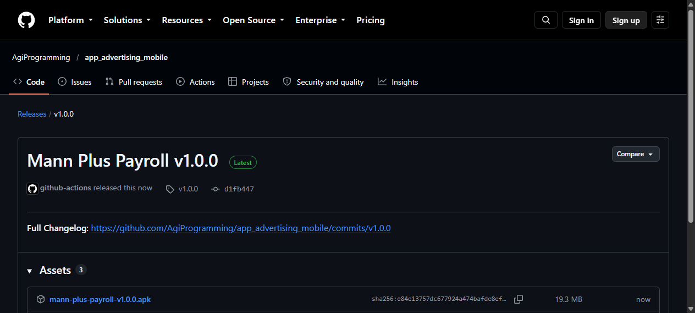{ width="300" }

**Berkas:** `33-rilis-apk-github-release.png`

**Isi:** Halaman **Release "Mann Plus Payroll v1.0.0"** berisi aset `mann-plus-payroll-v1.0.0.apk` (19,3 MB) dan catatan rilis otomatis.

**Fungsi:** **Bukti continuous delivery** — artefak siap pasang dihasilkan otomatis dari tag Git.

---

### Gambar 4.33 Pipeline penerbitan APK

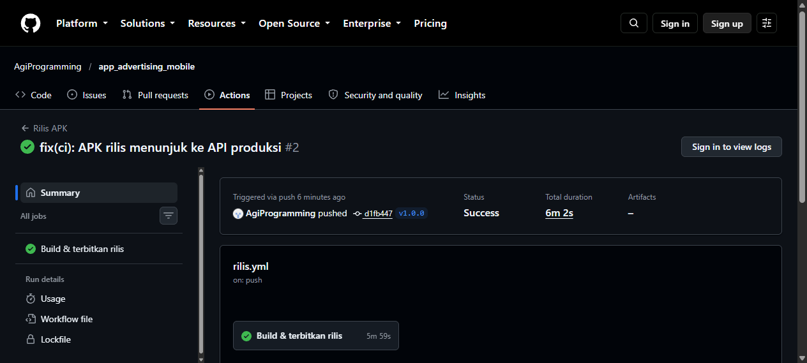{ width="300" }

**Berkas:** `34-ci-rilis-apk-run.png`

**Isi:** Run **Rilis APK** pada tag `v1.0.0`: langkah *Build APK rilis* → *Siapkan berkas rilis* → *Terbitkan GitHub Release*, semuanya hijau.

**Fungsi:** Menunjukkan rantai tag → build → publikasi berjalan tanpa campur tangan manual.

---

## E. Pengujian Notifikasi di Lingkungan Produksi

### Gambar 4.34 Notifikasi slip gaji diterima pada perangkat (produksi)

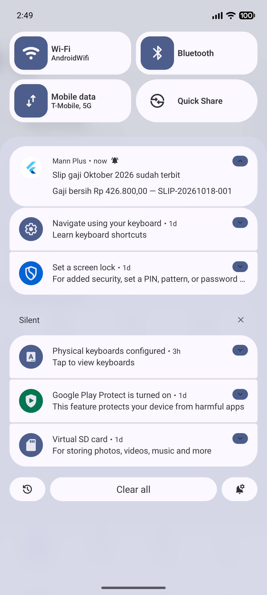{ width="300" }

**Berkas:** `35-push-produksi.png`

**Isi:** Notification shade Android menampilkan **Mann Plus** — "Slip gaji Oktober 2026 sudah terbit / **Gaji bersih Rp 426.800,00 — SLIP-20261018-001**", waktu **now**.

**Fungsi:** **Bukti push notification berjalan end-to-end di produksi**: server Laravel → Firebase Cloud Messaging (HTTP v1) → perangkat Android.

---

### Gambar 4.35 Beranda karyawan pada lingkungan produksi (sebelum slip diterbitkan)

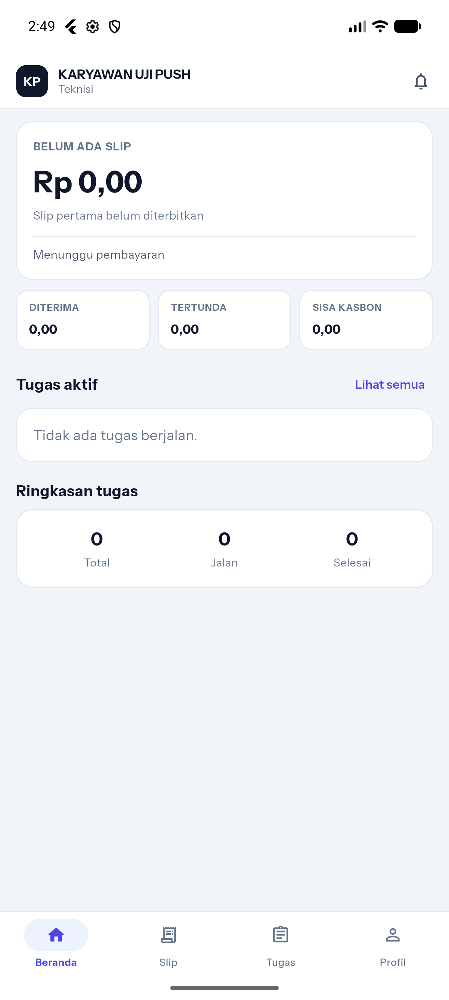{ width="300" }

**Berkas:** `36-beranda-karyawan-produksi.png`

**Isi:** Beranda karyawan pada server produksi: `KARYAWAN UJI PUSH / Teknisi`, kartu periode **BELUM ADA SLIP / Rp 0,00** dengan keterangan "Slip pertama belum diterbitkan", tiga kartu (DITERIMA 0,00 · TERTUNDA 0,00 · SISA KASBON 0,00), dan ringkasan tugas 0/0/0.

**Fungsi:** Menunjukkan aplikasi benar-benar terhubung ke API produksi (data berasal dari database hosting, bukan data lokal). Gambar ini diambil **sesaat sebelum** slip dibuat — jadi pas dipakai sebagai kondisi "sebelum", berpasangan dengan `35`/`37` sebagai kondisi "sesudah" (notifikasi masuk).

---

### Gambar 4.36 Riwayat notifikasi slip pada lingkungan produksi

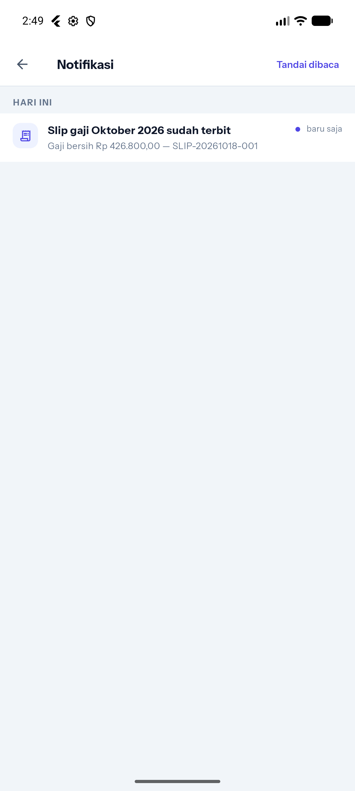{ width="300" }

**Berkas:** `37-notifikasi-produksi.png`

**Isi:** Daftar **Notifikasi** di dalam aplikasi: "Slip gaji Oktober 2026 sudah terbit · Gaji bersih Rp 426.800,00 — SLIP-20261018-001 · **baru saja**".

**Fungsi:** Menunjukkan notifikasi yang sama juga tersimpan sebagai riwayat in-app, bukan sekadar pop-up.

---

## Angka ringkasan untuk BAB IV

| Bukti | Angka |
|---|---|
| Pengujian backend | **53 test / 158 assertion** |
| Pengujian mobile | **8 test**, `flutter analyze` 0 issue |
| Format kode | 66 berkas dirapikan Laravel Pint |
| Waktu pipeline | CI 1m 12s · deploy 1m 10s · rilis APK 5m 30s |
| Ukuran APK | 19,3 MB |
| Contoh hitung 1 | 1.463.763 − 43.912,89 → komisi 312.367,02 + 100.000 − 200.000 = **212.367,02** |
| Contoh hitung 2 | 5.000.000 − 150.000 → komisi 22% = **1.067.000** |
| Contoh hitung 3 (produksi) | SPK 2.000.000 → slip **426.800,00** |
